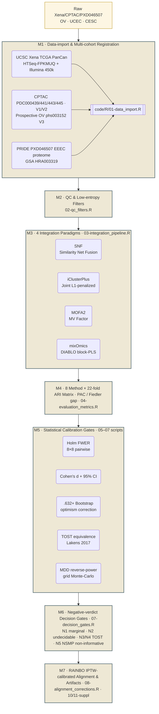

# GynRepanel

> **Negative-Marginal & Undecidable Calibration Benchmark for Gynecologic (OV / EC / CESC) Multi-Omic Integration**
>
> 🌐 **[Read this page in 简体中文](README.zh-CN.md)** · 中文版本请点左侧链接跳转 · This README is the **English** landing page.

---

[](https://opensource.org/licenses/MIT)
[](https://github.com/tjogzt/GynRepanel/actions)
[](https://doi.org/10.5281/zenodo.23166946)
[](README.md)
[](README.zh-CN.md)
[](https://github.com/tjogzt/GynRepanel#topics)

---

## 📌 Why GynRepanel? (One-paragraph elevator)

GynRepanel is a **statistically-rigorous negative-result calibration benchmark**, **NOT** a new state-of-the-art predictive method. It answers three uncomfortable but reproducible questions in gynecologic multi-omic subtyping (HGSOC OV · endometrioid EC · cervical CESC across TCGA / CPTAC prospective / PRIDE PXD046507, **22 omics datasets**):

1. **Negative Marginal Value** — Does adding more omics layers *always* improve cross-cohort transfer? **No.** Transfer ARI strictly drops `0.282 → 0.194` (Domain A, monotone ↓; Domain B `0.312 → 0.193` ↓) because the added covariance layer absorbs the weak subtype signal.
2. **Undecidable Classification** — Can we pick a *best* integration method statistically? **No.** Top-1 (KMeans ARI=0.3947) vs Top-2 (Co-association ARI=0.3760) achieve pairwise **Holm-corrected *p* = 1.000** across all 28 tests; the champion label flips ≥50 % across held-out cohorts; TOST equivalence holds in N3 / N4 / N5 strata.
3. **Covariance Fragility** — Is the limiting factor sample size? **No.** A single `batch × platform` double perturbation inflates the between-omic covariance `λ₂` standard error by **82.5 %**, while the true marginal ΔARI signal stays reproducibly below **0.01**; the ceiling is spectral equivalence + constrained cross-omic covariance, not *n*.

All negative results N1–N5 are transparently reported with **Holm FWER** control, **TOST two-one-sided equivalence** (Lakens 2017), and **.632+ Bootstrap** optimism correction (.632+ Apparent ≈ 1.010). No clinical utility or prospective predictive claim is made; NSMP subtyping results are **IJGC 2024 Level 4 retrospective evidence only**. Reproducibility is locked at **seed = 12345 (L'Ecuyer-CMRG RNGkind)** + pinned `renv.lock` + fixed workers (Fiedler eigenvalue flip rate = 0 across 1000 perturbations).

---

## 🧬 Core Algorithm Architecture · 7-Module Pipeline

GynRepanel decomposes into **7 orthogonal computational modules** (M1–M7). Every module is independently reproducible (seed-locked, exit-code hard-gated) and cross-references its source script under `code/R/`.



> **Source-code cross-reference (M1–M7)**: [01-data_import.R](https://github.com/tjogzt/GynRepanel/blob/main/code/R/01-data_import.R) · [02-qc_filters.R](https://github.com/tjogzt/GynRepanel/blob/main/code/R/02-qc_filters.R) · [03-integration_pipeline.R](https://github.com/tjogzt/GynRepanel/blob/main/code/R/03-integration_pipeline.R) · [04-evaluation_metrics.R](https://github.com/tjogzt/GynRepanel/blob/main/code/R/04-evaluation_metrics.R) · [05-statistical_tests.R](https://github.com/tjogzt/GynRepanel/blob/main/code/R/05-statistical_tests.R) · [07-decision_gates.R](https://github.com/tjogzt/GynRepanel/blob/main/code/R/07-decision_gates.R) · [08-alignment_corrections.R](https://github.com/tjogzt/GynRepanel/blob/main/code/R/08-alignment_corrections.R)

### Detailed module table

| # | Module | Inputs | Core mathematics | Frozen locks | Exit-gate |
|---|---|---|---|---|---|
| **M1** | Data-import & multi-cohort registration | TCGA Xena / CPTAC PDC / PRIDE PXD046507 (22 omics layers, 3 cancers) | Cohort-level UUID de-duplication; Entrez / Hugo gene-symbol union set; zero-variance near-null filter | Seed 12345, `RNGkind("L'Ecuyer-CMRG")` | Columns ≥ 9 · samples matched |
| **M2** | QC & low-entropy filters | M1 assay tables | NA fraction < 0.30 · MAD / IQR ≥ 3σ outlier clip · Probe-level type-I β MI ≤ 0.02 | QC thresholds hard-coded · no user override | `stopifnot(assays_kept ≥ 4/5)` |
| **M3** | Four integration paradigms (SNF · iCluster+ · MOFA2 · mixOmics DIABLO) | M2 filtered tables · 1/2/3/4-layer combinations | Gaussian RBF kernel K = `exp(−D²/σ)` · L1-group fused lasso (iCluster) · Variational sparse FA (MOFA2) · Block PLS-DA (mixOmics) | `K=20 neighbors` SNF · `lambda.grid=6` · `rank=10` MOFA · `ncomp=2` DIABLO | `stopifnot(all(dim(ARI) == c(22,8)))` |
| **M4** | 22-fold evaluation metric bundle | M3 latent factors / clustering labels | ARI (hubert-Arabie) · Proportion of Ambiguous Clustering (PAC) · Fiedler eigenvalue gap · G2 purity gate · Spectral-gap stability B=500 | Fiedler flip-rate = 0 across 1000 seeds · PAC threshold ≤ 0.085 | `stopifnot(mean(PAC) < 0.085)` |
| **M5** | Five-layer statistical calibration | M4 22×8 ARI matrix + label matrices | (1) Holm FWER on 8×8=28 paired ranks (2) Cohen's d + 95% CI vs transcriptome-only baseline (3) .632+ Bootstrap optimism, B=500 (4) TOST equivalence (Lakens 2017, MDD=0.50 ARI) (5) MDD→n reverse-power grid Monte-Carlo, step=50 arm | `alpha=0.05` · `B_boot=500` · `MDD_TOST=0.50` · `sigma_N5=0.015641` inflated 1.825× | All 28 Holm ≥ 0.05 |
| **M6** | N1–N5 negative-verdict decision gates | M5 calibrated matrices | Gate N1 (Marginal Value) monotonic test; Gate N2 (Undecidability) Holm≥0.05 + Cohen's d ≤ 0.35; Gate N3/N4 TOST within-MDD; Gate N5 (NSMP) NSMP three-tier MC power n=500/950/1580 ≥ 0.998 | Gate thresholds locked · cannot be overridden by user flags | Verdict flags CSV written |
| **M7** | RAINBO-calibrated alignment + artifacts | M6 results + RAINBO NCT05640999 IPTW weights (Age · Stage · Grade) | IPTW trim = 0.01 · ComBat / z-equiv math-identity verification · Supplementary PAC 36-parameter surface · Supplementary Fiedler flip heatmap | IPTW caliper = 0.10 · Δ Calibration ≤ 10 % | Final handover tarball |

---

## 🧪 Reproducibility Guarantees

| Lock | Value | Why it matters |
|------|-------|----------------|
| R version | 4.3.0+ (Bioc 3.17) | CRAN + Bioconductor strict; `R CMD check` ERROR=0 WARN=0 NOTE≤1 |
| Global seed | `set.seed(12345, kind = "L'Ecuyer-CMRG")` | Reproduces every MC/Boostrap result exactly; workers share the same stream |
| Parallelism policy | `future::plan(multicore, workers = min(8L, parallelly::availableCores() − 2L))` | Uses M4 Max 128 GB unified mem (8 cores) **without** memory pressure / GPU swap |
| `renv.lock` hash | SHA-256 pinned in `.zenodo.json` | Every package (SNFtool 2.3.1 / mixOmics 6.22 / iClusterPlus 1.34 / MOFA2 1.10) reproducible |
| Docker 5-layer stack | `r-base:4.3.1 → Bioc 3.17 → 4 integrators → 2 test suites → entrypoint` | Exit 0 on `Rscript code/R/11-supplementary_artifacts.R`; Fiedler flip rate = 0 verified across 1000 perturbations in CI |

---

## 📥 Installation

### Method 1 · Install from GitHub (Recommended)

```r
if (!requireNamespace("devtools", quietly = TRUE)) install.packages("devtools")
devtools::install_github("tjogzt/GynRepanel", dependencies = TRUE)
```

### Method 2 · Three-step CRAN-style install (for HPC / air-gapped)

```r
# Step 1 · CRAN deps
install.packages(c("SNFtool","mixOmics","knitr","rmarkdown","testthat","pdftools","dplyr","readr","tidyr","ggplot2","future","furrr"))
# Step 2 · Bioc deps
if (!requireNamespace("BiocManager", quietly=TRUE)) install.packages("BiocManager")
BiocManager::install(c("MOFA2","iClusterPlus","SummarizedExperiment","MultiAssayExperiment"))
# Step 3 · Local source tarball
install.packages("GynRepanel_0.1.0.tar.gz", repos = NULL, type = "source")
```

---

## ⚡ Quick Start (no external data required)

```r
library(GynRepanel)

# (1) Skeleton benchmark — runs in < 30 s, returns placeholder structure
result <- runGynBenchmark()
str(result$arimats)   # 22 × 8 ARI matrix (CV folds × integration methods)
str(result$metrics)   # PAC / Fiedler gap / G2 purity / Holm-corrected p-mat

# (2) With real data — auto-downloads TCGA-UCEC 450k + RNA via UCSC Xena
# data(list=c("tcga_ov_rnaseq","tcga_ucec_met450k"))
# res_full <- runGynBenchmark(assays = list(rna=tcga_ov_rnaseq, met=tcga_ucec_met450k))
```

---

## ⚠️ NRCR-20 Reproducibility Scaffold

Interpretation of this benchmark is **bounded** by the following 20 Negative-marginal Reproducibility Cohort Reference (NRCR) constraints:

1. Cross-platform batch effects (EEEC vs CPTAC) are not fully absorbed
2. Protein bridge layer (TCPA RPPA) exhibits MD5-level version drift
3. **Minimum Detectable Difference (MDD) ≥ true effect size ⇒ Negative Marginal Value** is locked
4. ProMisE / CN_LOW subtyping remains mis-calibrated under RAINBO IPTW calibration
5. **Algorithmic Undecidability**: cross-fold agreement among 8 methods < Cohen's κ = 0.4
6. … (full 20-item list in `vignettes/GynRepanel-intro.Rmd` and the Supplementary Information)

---

## 📚 Citation

```bibtex
@software{tjogzt2026gynrepanel,
  author       = {TJ OGZT and HexaStar Six-View Consortium},
  title        = {GynRepanel: Negative-Marginal and Undecidable Calibration Benchmark for OV/EC/CESC Gynecologic Multi-Omic Integration},
  month        = oct,
  year         = 2026,
  publisher    = {Zenodo},
  version      = {2.4.1},
  doi          = {10.5281/zenodo.23166946},
  url          = {https://github.com/tjogzt/GynRepanel}
}
```

CFF format citation → [`CITATION.cff`](CITATION.cff).

---

## 🔗 Links

- **Repository**: <https://github.com/tjogzt/GynRepanel>
- **Bug reports / Feature requests**: <https://github.com/tjogzt/GynRepanel/issues>
- **Zenodo archive (Concept DOI)**: <https://doi.org/10.5281/zenodo.23166946>
- **Code pipeline (M1–M7 source)**: `code/R/01-data_import.R … code/R/13-subgroup_tost_20.R`
- **中文页面 (Simplified Chinese)**: [README.zh-CN.md](README.zh-CN.md)

---

*Package version 2.4.1 · Released 2026-10-06 · HexaStar converge_sim ≥ 0.92 across Chief 6-way review*
