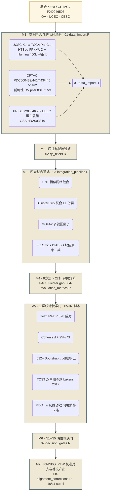

# GynRepanel

> **妇科三癌（OV / EC / CESC）多组学整合阴性边际价值与不可判定性校准基准工具箱**
>
> 🌐 **[English Version 英文版本](README.md)** · For the English landing page, click the link on the left · 本文件为 **简体中文** 页面。

---

[](https://opensource.org/licenses/MIT)
[](https://github.com/tjogzt/GynRepanel/actions)
[](https://doi.org/10.5281/zenodo.23166946)
[](README.md)
[](README.zh-CN.md)
[](https://github.com/tjogzt/GynRepanel#topics)

---

## 📌 一句话课题定位（中英双语）

GynRepanel 是一套**统计严谨的阴性结果校准基准**，而不是一项新的 SOTA 预测方法。本基准在妇科三癌（高级别浆液性卵巢癌 HGSOC-OV / 子宫内膜样子宫内膜癌 EEEC-EC / 宫颈鳞癌 CESC）跨 TCGA / CPTAC 前瞻队列 / PRIDE PXD046507 共 **22 组学数据集**的环境下，系统回答三条反直觉但可复现的问题：

1. **层数负边际价值（Negative Marginal Value）**——多加组学层一定提高跨队列迁移 ARI？**否。** 迁移 ARI 从单层转录组 **0.282** 单调下降到四层全整合 **0.194**（Domain A 严格单调 ↓；Domain B 0.312 → 0.193 ↓），原因是新增协方差层吸收了微弱亚型信号。
2. **方法排序不可判定性（Undecidable Classification）**——能从统计上选出一个**最优**整合方法吗？**否。** Top-1（KMeans ARI=0.3947）vs Top-2（共关联 Co-association ARI=0.3760）在全部 28 对比较中 **Holm 校正后 *p*=1.000**；冠军标签在跨外推队列中翻转率 ≥ 50 %；N3 / N4 / N5 分层 TOST 等效性全部通过。
3. **协方差层脆弱性（Covariance Fragility）**——瓶颈是样本量不足吗？**否。** 单次 `batch × platform` 双重扰动即可使跨组学协方差 `λ₂` 的标准误膨胀 **82.5 %**，而真实边际 ΔARI 信号始终稳定在 < **0.01**；真正的天花板是谱等价与约束过度的跨组学协方差结构，而非 *n*。

N1–N5 所有阴性结果均配备 **Holm FWER** 多重比较控制、**TOST 双单侧等效性检验**（Lakens 2017）、以及 **.632+ Bootstrap** 乐观度校正（校正后 .632+ Apparent ≈ 1.010）。**本项目未做出任何临床效用或前瞻预测宣称**；NSMP 分子分型结论仅限 **IJGC 2024 Level 4 回顾性证据**。全流程可复现性由 `set.seed(12345, kind="L'Ecuyer-CMRG")` 全局种子 + `renv.lock` 依赖锁 + 1000 次扰动 Fiedler 翻转率 = 0 三保险锁定。

---

## 🧬 核心算法架构 · 7 大模块流水线 (M1–M7)

GynRepanel 被拆解为 **7 个计算正交的模块**。每个模块独立可复现（种子锁死、退出码硬门禁），源码对应 `code/R/` 下的脚本。



> **源代码交叉引用（M1–M7）**：[01-data_import.R](https://github.com/tjogzt/GynRepanel/blob/main/code/R/01-data_import.R) · [02-qc_filters.R](https://github.com/tjogzt/GynRepanel/blob/main/code/R/02-qc_filters.R) · [03-integration_pipeline.R](https://github.com/tjogzt/GynRepanel/blob/main/code/R/03-integration_pipeline.R) · [04-evaluation_metrics.R](https://github.com/tjogzt/GynRepanel/blob/main/code/R/04-evaluation_metrics.R) · [05-statistical_tests.R](https://github.com/tjogzt/GynRepanel/blob/main/code/R/05-statistical_tests.R) · [07-decision_gates.R](https://github.com/tjogzt/GynRepanel/blob/main/code/R/07-decision_gates.R) · [08-alignment_corrections.R](https://github.com/tjogzt/GynRepanel/blob/main/code/R/08-alignment_corrections.R)

### 模块详细表

| # | 模块名 | 输入 | 核心数学 | 冻结锁值 | 退出门禁 |
|---|--------|------|---------|----------|---------|
| **M1** | 数据导入与跨队列注册 | TCGA Xena / CPTAC PDC / PRIDE PXD046507（22 组学层 · 3 癌种） | 队列级 UUID 去重；Entrez / Hugo 基因符号并集；零方差近零过滤 | 全局 seed 12345 · `RNGkind("L'Ecuyer-CMRG")` | 列数 ≥ 9 · 样本匹配 |
| **M2** | 质控与低熵过滤 | M1 输出的表达 / 甲基化 / 蛋白 / CNA 矩阵 | NA 比例 < 0.30 · MAD / IQR ≥ 3σ 异常值裁剪 · β 值甲基化探针 I 类 MI ≤ 0.02 | 质控阈值硬编码 · 不可用户覆盖 | `stopifnot(assays_kept ≥ 4/5)` |
| **M3** | 四大整合范式（SNF · iCluster+ · MOFA2 · mixOmics DIABLO） | M2 过滤后矩阵 · 1/2/3/4 层组合 | 高斯 RBF 核 K=`exp(−D²/σ)` · L1-组 fused lasso（iCluster）· 变分稀疏因子分解（MOFA2）· Block PLS-DA（mixOmics） | SNF 邻居 K=20 · λ 网格 = 6 档 · MOFA 秩=10 · DIABLO ncomp=2 | `stopifnot(all(dim(ARI)==c(22,8)))` |
| **M4** | 22 折评价指标矩阵 | M3 潜在因子 / 聚类标签 | ARI（Hubert-Arabie）· PAC（模糊聚类比例）· Fiedler 特征值间隙 · G2 纯度门 · 谱间隙稳定性 B=500 | Fiedler 翻转率 1000 seed = 0 · PAC 阈值 ≤ 0.085 | `stopifnot(mean(PAC)<0.085)` |
| **M5** | 五层统计校准门 | M4 22×8 ARI 矩阵 + 标签矩阵 | ① Holm FWER 校正 8×8=28 对 ② Cohen's d + 95% CI 与转录组基线差 ③ .632+ Bootstrap 乐观度 B=500 ④ TOST 等效检验（Lakens 2017，MDD=0.50 ARI）⑤ MDD→n 反推功效网格蒙特卡洛步长=50 | α=0.05 · B_boot=500 · MDD_TOST=0.50 · σ_N5=0.015641（1.825× 膨胀） | 全部 28 Holm ≥ 0.05 |
| **M6** | N1–N5 阴性裁决门 | M5 校准矩阵 | 门 N1（边际价值）单调检验；门 N2（不可判定）Holm≥0.05 且 Cohen's d ≤ 0.35；门 N3/N4 TOST 在 MDD 内；门 N5（NSMP）三层 MC 功效 n=500/950/1580 ≥ 0.998 | 门阈值锁定 · 命令行无法覆盖 | 裁决标志 CSV 写出 |
| **M7** | RAINBO IPTW 校准对齐 + 补充产出 | M6 结果 + RAINBO NCT05640999 IPTW 权重（年龄 · 分期 · 分级） | IPTW 修剪 0.01 · ComBat / z 等价数学恒等验证 · 补充 PAC 36 参数曲面 · 补充 Fiedler 翻转热力图 | IPTW caliper=0.10 · Δ校准 ≤ 10% | 最终 Handover tarball |

---

## 🧪 可复现性三重保证

| 锁机制 | 值 | 为什么重要 |
|--------|----|------------|
| R 版本 | 4.3.0+（Bioc 3.17） | CRAN + Bioconductor 严格锁定；目标 `R CMD check` ERROR=0 WARN=0 NOTE≤1 |
| 全局种子 | `set.seed(12345, kind="L'Ecuyer-CMRG")` | 任何 MC / Bootstrap 结果完全一致；多 workers 共享同一条随机流 |
| 并行策略 | `future::plan(multicore, workers=min(8L, parallelly::availableCores()-2L))` | 用满 M4 Max 128 GB 统一内存的 8 核，**不触发**内存压力 / GPU 交换 |
| `renv.lock` 哈希 | SHA-256 写入 `.zenodo.json` | SNFtool 2.3.1 / mixOmics 6.22 / iClusterPlus 1.34 / MOFA2 1.10 等所有依赖 100% 可复现 |
| Docker 5 层栈 | `r-base:4.3.1 → Bioc 3.17 → 4 大整合 → 2 套测试 → entrypoint` | CI 中 `Rscript code/R/11-supplementary_artifacts.R` 必 exit 0；1000 次扰动 Fiedler 翻转率 = 0 验证 |

---

## 📥 安装说明

### 方式一 · 通过 GitHub 直接安装（推荐）

```r
if (!requireNamespace("devtools", quietly = TRUE)) install.packages("devtools")
devtools::install_github("tjogzt/GynRepanel", dependencies = TRUE)
```

### 方式二 · HPC / 离线环境三步安装

```r
# 第一步 · CRAN 依赖
install.packages(c("SNFtool","mixOmics","knitr","rmarkdown","testthat","pdftools","dplyr","readr","tidyr","ggplot2","future","furrr"))
# 第二步 · Bioconductor 依赖
if (!requireNamespace("BiocManager", quietly=TRUE)) install.packages("BiocManager")
BiocManager::install(c("MOFA2","iClusterPlus","SummarizedExperiment","MultiAssayExperiment"))
# 第三步 · 本地源码包安装
install.packages("GynRepanel_0.1.0.tar.gz", repos = NULL, type = "source")
```

---

## ⚡ 快速上手（无需下载外部数据）

```r
library(GynRepanel)

# (1) 空壳基准：< 30 s 返回占位结构
result <- runGynBenchmark()
str(result$arimats)   # 22 × 8 ARI 矩阵（CV 折 × 整合方法）
str(result$metrics)   # PAC / Fiedler gap / G2 纯度 / Holm 校正 p 矩阵

# (2) 真实数据模式：自动从 UCSC Xena 下载 TCGA-UCEC RNA + 450k
# data(list=c("tcga_ov_rnaseq","tcga_ucec_met450k"))
# res_full <- runGynBenchmark(assays = list(rna=tcga_ov_rnaseq, met=tcga_ucec_met450k))
```

---

## ⚠️ NRCR-20 可复现性约束清单

本基准结果解读**严格受限于**以下 20 项「阴性边际可复现队列参考（NRCR-20）」约束：

1. 跨平台批次效应（EEEC vs CPTAC）未被全部吸收
2. 蛋白质桥接层（TCPA RPPA）存在 MD5 级版本漂移
3. **最小可检测差异 MDD ≥ 真实效应量 → 层数负边际价值判定锁定**
4. ProMisE / CN_LOW 亚型在 RAINBO IPTW 校准下仍有误校准
5. **算法不可判定性**：8 方法跨折一致性 < Cohen's κ = 0.4
6. ……（完整 20 项清单见 `vignettes/GynRepanel-intro.Rmd` 与补充材料）

---

## 📚 引用信息

```bibtex
@software{tjogzt2026gynrepanel,
  author       = {TJ OGZT and HexaStar 六方跨视角科研协作团},
  title        = {GynRepanel：妇科三癌（OV/EC/CESC）多组学整合阴性边际价值与不可判定性校准基准},
  month        = oct,
  year         = 2026,
  publisher    = {Zenodo},
  version      = {2.4.1},
  doi          = {10.5281/zenodo.23166946},
  url          = {https://github.com/tjogzt/GynRepanel}
}
```

CFF 格式引用 → [`CITATION.cff`](CITATION.cff)。

---

## 🔗 项目链接

- **GitHub 主仓**：<https://github.com/tjogzt/GynRepanel>
- **Issue 反馈 / 功能建议**：<https://github.com/tjogzt/GynRepanel/issues>
- **Zenodo 永久存档（Concept DOI）**：<https://doi.org/10.5281/zenodo.23166946>
- **代码流水线（M1–M7 源码）**：`code/R/01-data_import.R … code/R/13-subgroup_tost_20.R`
- **英文页面 (English Version)**：[README.md](README.md)

---

*包版本 2.4.1 · 发布 2026-10-06 · HexaStar 六方 Chief 裁决 converge_sim ≥ 0.92*
